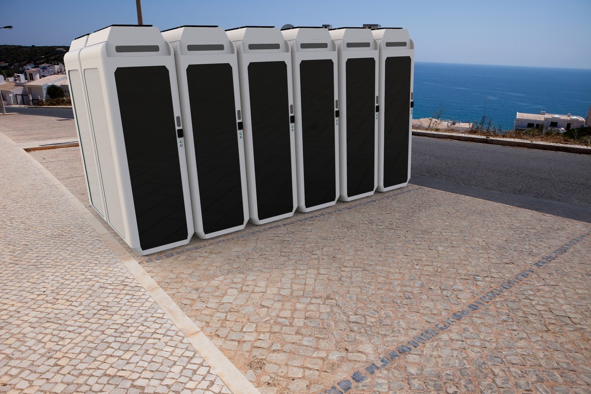

# Modelado 3D y CAE

Trabajos de modelado y análisis del Grado en Diseño Industrial (EUDI, Universidade da Coruña), hechos con SolidWorks, Rhino y KeyShot.

## Llanta de aleación
Modelada en SolidWorks siguiendo la normativa de llantas (UNE 69018 y 69026), con renders en KeyShot y varios acabados.

 

## Módulo para un terminal de bicicletas
Proyecto en grupo: un módulo que se repite en batería. Renders en contexto.

## Esculturas a partir de Malevich
Composiciones suprematistas llevadas a 3D: relieve y esculturas de mesa.

 

## Elementos finitos
Mallado de piezas (elementos sólidos y de lámina), cargas, sujeciones y lectura de tensiones y desplazamientos con SolidWorks Simulation.

---
Daniel Roca Martínez · [Currículum](https://daniroca5.gamer.gd/cv/)
