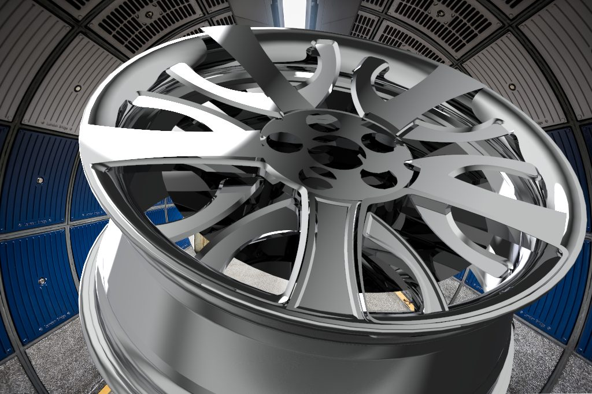

# Modelado 3D y CAE

Trabajos de **modelado 3D, análisis y visualización** del Grado en Ingeniería en Diseño Industrial y Desarrollo de Producto (EUDI, Universidade da Coruña). Herramientas principales:
- **SolidWorks** para el modelado paramétrico y el análisis;
- **Rhinoceros** para las superficies libres;
- **KeyShot** para los renders.

## 1. Llanta de aleación (SolidWorks + KeyShot)

Diseño de una **llanta de automóvil** en la asignatura de tecnologías de prototipado, desde la documentación técnica hasta el render final:

- **Documentación**: funciones de la rueda (soportar la carga, transmitir la potencia y formar parte de la dirección y la suspensión) y la **normativa de llantas** (UNE 69018 y UNE 69026).
- **Bocetos y estudio de forma** de los radios, hasta llegar a un dibujo de radios en «Y».
- **Modelado paramétrico en SolidWorks**: perfil de revolución para el aro y patrón circular de radios, con variaciones del diseño y una versión en Rhino para retocar superficies.
- **Renders en KeyShot**: acabados en aluminio pulido, pintado y combinaciones bitono, en varios entornos de iluminación HDRI.

## 2. Módulo para un terminal de bicicletas (proyecto en grupo)

En *Diseño y Producto* trabajamos en grupo para una empresa colaboradora sobre **nuevos conceptos de terminal de bicicletas**. El proceso fue el de siempre:
1. **fase de información**: mercado, producto, competencia, materiales y fabricación;
2. **fase creativa**;
3. un **módulo final** que se repite en batería.

Mi parte incluyó la **identidad corporativa** del grupo y los **renders en contexto** del módulo: de día, junto al mar, y de noche, en un aparcamiento.

## 3. Estética: esculturas a partir de Malevich

En *Estética* reinterpreté el **suprematismo de Kazimir Malevich** en 3D: composiciones de planos y volúmenes puros (cuadrados, rectángulos, cruces) que en el cuadro flotan y aquí hay que sostener. El trabajo fue de **equilibrio y estructura**: dónde apoyar cada pieza y qué ejes la sujetan. Salieron un relieve de pared y varias esculturas de mesa, todas renderizadas en KeyShot.

## 4. Análisis por elementos finitos

En la asignatura de *Análisis* trabajé el **cálculo por elementos finitos (CAE)** con SolidWorks Simulation:
- **preparar el modelo**: simplificarlo y pasar de sólido a superficie media cuando la pieza es delgada;
- **mallar** con elementos sólidos o de **lámina** (por ejemplo, una placa taladrada);
- aplicar **sujeciones y cargas** y leer los resultados de **tensiones y desplazamientos**.

Es la misma lógica que se aplica después a piezas como la llanta.

## Lo que me llevo

Pasar de una idea a un **modelo que se puede fabricar y calcular**, y luego **comunicarlo** con renders y planos. En resumen: diseño, ingeniería y presentación en un mismo flujo.

---

Daniel Roca Martínez · [Currículum](https://daniroca5.gamer.gd/cv/) · [LinkedIn](https://www.linkedin.com/in/daniel-r-m-02b369164/)
